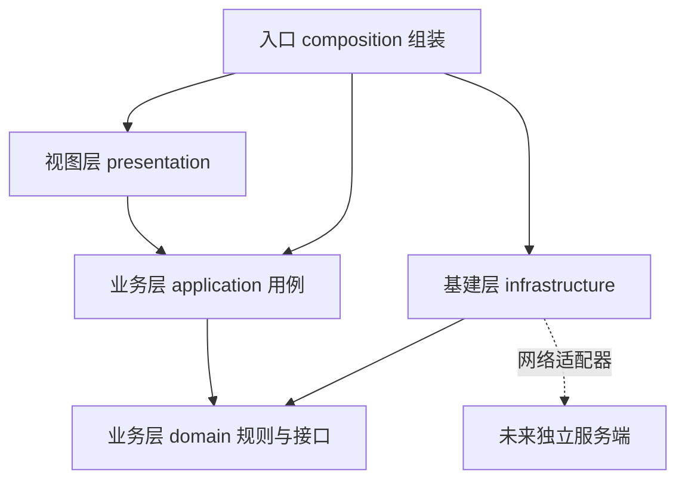

# 技术选型与分层架构

日期：2026-10-23。状态：设计基线；已完成分层基建、本地学习体验版和 v0.2 词库增强（16,053 词头离线查询、170 个精选替换义项、词频分级与中文分词边界），实际交付范围和限制见 README。本文件中的全量词库分片、独立接触记录、数据库分页和服务端同步属于后续建设目标。

## 1. 目标和范围

产品闭环：中文网页遇见英文 → 悬停理解 → 加入学习 → 网页复现 / 主动复习 → 更新个人熟悉度。

已确认方向：本地词典、网页适量替换、问号角标与悬停卡片、单词本、难度与熟悉度区分、可选 AI、官方预设、自定义接口和模型选择。AI 协议计划覆盖 OpenAI Chat Completions、OpenAI Responses、Anthropic Messages；不接入 Gemini 侧边栏。

尚需体验验证的产品参数：默认词汇档位、每页新词数、每段替换上限、熟词是否继续显示、复习间隔。这些参数配置化，不硬编码进视图。

首版只交付 Chrome 扩展，本地功能不依赖登录或服务端。未来可增加账号、跨设备同步和远端词库；当前无需预建服务端。

## 2. 选型结论

| 范围         | 选型                                                | 原因与边界                                                          |
| ------------ | --------------------------------------------------- | ------------------------------------------------------------------- |
| 扩展标准     | Chrome Manifest V3                                  | 首版面向 Chrome，后续再验证其他 Chromium 浏览器                     |
| 工程框架     | WXT，使用其 Vite 构建能力                           | 统一管理后台、内容脚本、popup 和 options 入口，避免自维护多入口打包 |
| 语言         | TypeScript strict                                   | 业务对象、跨环境消息和外部响应均有明确类型                          |
| 视图         | React + WXT React 模块                              | 复用词汇卡片、设置表单、单词本和复习组件                            |
| 样式         | CSS Modules + CSS Variables 设计令牌                | 降低全局样式耦合；网页悬浮卡片另外使用 Shadow DOM 隔离              |
| 悬浮定位     | Floating UI                                         | 管理浮层翻转、边界避让和锚点跟随；交互自行管理键盘和焦点            |
| 状态         | React hooks 为主，必要时按页面引入 Zustand          | 仅存 UI 临时状态；不将内存 store 当成数据库或跨环境总线             |
| 小型配置     | chrome.storage.local，封装为 SettingsStore          | 适合设置和监听变更；业务和组件不直接操作 Chrome 存储                |
| 结构化持久化 | IndexedDB + Dexie                                   | 单词、复习记录和缓存需要索引、事务、分页和版本迁移                  |
| 边界校验     | Zod                                                 | 校验消息、配置导入、数据库迁移输入及 AI 输出                        |
| 网络         | 原生 fetch + AbortController                        | 在后台适配器中统一超时、取消和错误映射，首版不额外引入 Axios        |
| 测试         | Vitest + Testing Library；Playwright 做扩展集成测试 | 规则用单测，真实网页和 MV3 生命周期用浏览器验证                     |
| 质量工具     | ESLint + typescript-eslint + Prettier               | 通过导入限制和类型检查落实分层                                      |
| 包管理       | pnpm，单应用仓库                                    | 锁定依赖；暂不拆 monorepo，不引入工作流编排平台                     |

初始化时选择相互兼容的稳定版本，记录 Node 和 pnpm 版本，提交 pnpm-lock.yaml；本选型文档不凭记忆指定第三方最新版本。

首版暂不引入 Next.js、SSR、Redux、通用 DI 容器、微服务或自行搭建协议代理。React 并非不可替换，核心业务不依赖它。

## 3. 三层与依赖规则

逻辑上保留用户要求的三层，业务层内部再区分纯规则和用例。依赖方向与运行时调用方向分开看：业务定义所需接口，基建实现接口，在入口处组装。



| 层         | 职责                                                                        | 禁止事项                                                      |
| ---------- | --------------------------------------------------------------------------- | ------------------------------------------------------------- |
| 基建层     | 浏览器 API、消息传输、数据库、词典读取、HTTP、AI 协议、DOM 适配、权限、日志 | 不决定哪个难度适合用户、不计算复习规则                        |
| 业务层     | 候选生成、词义筛选、替换预算、熟悉度、学习计划、供应商配置与业务用例        | 不导入 React、WXT、Chrome、Dexie，不接触真实 DOM 或直接 fetch |
| 视图层     | popup、悬停卡片、单词本、复习、设置及交互状态                               | 不直接访问数据库、Key 或 AI 接口，不编写学习规则              |
| 入口与组装 | 创建适配器、注入用例、注册监听、连接视图                                    | 不积累业务判断                                                |

业务接口使用明确的异步方法和普通对象；通过构造参数或工厂注入依赖，不使用全局服务定位器。提供 Clock、IdGenerator 等小接口，方便确定性测试。

计划用 ESLint 在 CI 中限制 domain/application 的外部依赖，限制 presentation 引入具体基建。contracts 只能包含消息 DTO、边界 schema 和协议版本，不能变成共享杂物目录。

## 4. 分层与扩展运行环境是两条轴

不是“视图全在页面、业务全在后台”。每个环境只组装需要的能力，纯业务模块可以被不同入口复用。

| 环境                      | 承担工作                                                                   | 不承担工作                                  |
| ------------------------- | -------------------------------------------------------------------------- | ------------------------------------------- |
| Content Script            | 观察网页、提取文本、构建候选、提交分析、校验原文、应用或恢复替换、挂载卡片 | 获取 Key、直连服务商、读取扩展数据库        |
| Background Service Worker | 验证消息与来源、读取设置和学习记录、最终决策、数据库写入、AI 请求、缓存    | DOM 操作、依赖常驻内存保存事实数据          |
| Popup                     | 总开关、当前网站开关、状态和功能入口                                       | 长任务、完整单词本                          |
| Options 扩展页面          | 设置、服务商配置、完整单词本、主动复习、导入导出                           | 直接持有数据访问实现或把 Key 回传给内容脚本 |

单词本和复习首版放在完整扩展页面，popup 只放快捷入口；侧边栏作为后续可选视图，不影响业务接口。

后台可能被 Chrome 回收。监听器在入口同步注册，初始化通过可重入的 ready Promise 完成；数据库迁移完成后处理业务。队列和缓存可失效，收藏与复习事实必须先提交事务再返回成功。

AI 使用有界短请求，初始总预算 20 秒，随真实测试调整。后台终止、页面跳转或超时均视为可恢复失败：回退本地方案，不依赖保活技巧。不承诺对推理请求进行端到端 exactly-once；网络结果不明时不自动重发可能计费的生成请求。

## 5. 模块划分和关键接口

| 模块        | 业务内容                                 | 主要接口                                             |
| ----------- | ---------------------------------------- | ---------------------------------------------------- |
| dictionary  | 词条、词义、词形、候选映射、来源         | DictionaryPort、DictionaryPackLoader                 |
| replacement | 文本片段、难度过滤、去重、预算、替换计划 | AnalyzeSegments、ValidatePlan、ReplacementPolicy     |
| learning    | 加入学习、个人熟悉度、网页接触记录       | VocabularyRepository、SaveVocabulary、RecordExposure |
| review      | 到期队列、作答记录、下一次复习时间       | ReviewRepository、ReviewScheduler、SubmitReview      |
| providers   | 服务配置、协议、模型列表、连接测试       | ProviderRepository、SecretStore、ModelCatalogPort    |
| ai          | 语境判断、例句补充、输出规范化           | ContextAnalyzer、LearningEnricher                    |
| settings    | 学习档位、网站规则、AI 开关和请求预算    | SettingsStore、SitePolicy                            |

替换业务接收 TextSegment 和词汇候选，输出 ReplacementPlan，不输出 HTML。定位使用 segmentId、原文版本、UTF-16 起止位置、原中文、英文及 senseId；内容脚本拥有 segmentId 到 TextNode 的本地映射，消息中不传 DOM 对象。

应用前验证原文版本、范围、原词匹配、重叠和替换预算；页面变动则丢弃或重新分析对应片段。AI 不能绕过难度限制、网站策略和每页预算。

词汇等级与个人熟悉度分别建模。复习算法通过 ReviewScheduler 隔离，首版使用可解释的间隔规则，后续可替换更复杂算法；网页展示次数不直接提升掌握状态。

## 6. 消息契约

跨环境用类型化 chrome.runtime 消息包装，Zod 做运行时验证；业务用例不知道消息传输细节。先定义契约，再实现生产者和消费者。

消息包含 version、requestId、type、payload，响应使用统一的成功 / 失败结构。首批消息：AnalyzeSegments、GetWordCard、SaveVocabulary、MarkFamiliarity、ListVocabulary、SubmitReview、GetSettings、UpdateSettings、ListProviderModels、TestProvider、SaveProvider。

内容脚本只允许调用网页学习相关消息；服务配置、模型测试、导入导出和 Key 更新仅允许可信扩展页面。后台校验 sender.id、sender.tab、sender.url / origin 和允许的页面路径，不能相信 payload 中自称的来源身份。

后台根据 sender 的 tab、frame、document 和 URL 绑定分析任务。段落返回结果携带文档版本，跨页面旧响应不得应用。单词本变更通知只发送失效信息，界面收到后按分页重新查询，不广播整库数据。

统一错误码包括 INVALID_INPUT、PERMISSION_REQUIRED、AUTH_INVALID、MODEL_UNAVAILABLE、RATE_LIMITED、TIMEOUT、BAD_MODEL_OUTPUT、STORAGE_FAILED；额度不足在上游能明确识别时细分。无法识别的错误不假装精确，展示脱敏后的说明。

## 7. 数据与词典

### 存储责任

- chrome.storage.local：非敏感设置、网站规则、服务配置元数据；设置可信上下文访问级别，内容脚本经受限消息读取必要子集。
- chrome.storage.session：默认保存 API Key，后台重启可重新读取；浏览器会话结束后需要重新填写。
- 用户选择“记住 Key”后使用受限的 chrome.storage.local；不声称浏览器本地存储是加密保险箱，不把加密密钥与密文放在一起假装安全。
- IndexedDB / Dexie：仅扩展后台的数据适配器访问，保存学习数据、索引和缓存。前台通过用例客户端访问。
- 安装包静态资源：版本化词典包。页面不每次加载整本大词典。

### 主要数据集

| 数据集           | 关键字段和约束                                                       |
| ---------------- | -------------------------------------------------------------------- |
| vocabulary       | 稳定 UUID、lemma、pos、senseId、熟悉度、时间、revision；词义维度去重 |
| encounters       | vocabularyId、原词、上下文、来源和时间；设置条数及长度上限           |
| reviewEvents     | 唯一 eventId、词义标识、结果、作答时间、算法版本                     |
| reviewState      | 词义标识、下次到期时间及调度状态；作答事件和状态同事务提交           |
| providerProfiles | 稳定 ID、协议、baseUrl、modelId、secretRef、配置版本；不内嵌 Key     |
| aiCache          | 有界缓存，按文段散列、模型、配置版本、词典版本和提示词版本区分       |

缓存不跨不同用户水平或熟悉度盲目复用最终替换计划：缓存语境分析，最终难度和预算在使用时重新计算。Key、完整请求头和完整原始响应不写入缓存。

词典以 ECDICT 常用词子集作为候选基础，先完成来源和授权清单，再生成运行包；中文到英文映射需要人工整理和校验，不能把英汉释义机械反转。CC-CEDICT 可作为后续可选来源，单独记录数据许可。

构建脚本负责归一化、词义 ID、分级、候选映射和索引。运行时采用版本化分片 + 按需加载 + 有界缓存；不首发打包全量数十万词进内容脚本，不在运行时依赖 Python 或 SQLite。

每个词典包包含来源、许可证、版本、校验值和等级规则版本。等级允许 unknown；先用经过校验的子集验证学习体验，词频和考试标签只是参考，不冒充正式 CEFR 标准。

数据迁移有版本和回滚前备份策略，导入校验 schema、大小、版本和重复记录。默认导出只含学习数据和非敏感配置，不含 Key。卸载插件会丢失本地数据，设置页提供清晰的备份入口。

## 8. AI 与 HTTP 基建

ProviderAdapter 负责协议差异，HttpTransport 负责 fetch、超时、取消、响应大小限制、错误归一化和脱敏日志。业务只依赖 ContextAnalyzer 等能力接口，不依赖厂商 SDK 类型。

官方预设就是一份经过测试的配置模板，自定义服务也走相同机制。支持保存多配置，首版只有一个主动使用的配置。模型支持拉取、搜索和手填；列表失败不阻断手填；连接测试包含真实短任务和结构校验。

明确区分 Chat Completions、Responses 和 Messages，不按厂商名称猜协议。baseUrl 有统一含义，预设负责补齐路径，保存时展示最终测试地址，避免重复 /v1。自定义完整路径放高级选项，首版不做任意脚本或任意请求模板。

模型列表端点可以与推理端点配置不同路径，但首版必须同源；不将同一个 Key 自动发送到另一域名。请求重定向不能携带凭证被静默转发到新来源。

普通生成首版采用非流式结构化响应，按文本块返回结果；优先简单可验证的 JSON，不能依赖所有兼容服务都实现同一种 JSON Schema 扩展。解析失败即回退，禁止执行模型生成的脚本或 HTML。

本地缓存 → 基础候选 → 可选语境请求 → 输出验证 → 业务限制 → 替换计划。AI 开关、网站授权和预算均通过后才发送必要文段；网页内容属于不可信输入，不能改变系统任务或要求调用工具。

初始每标签页最多 1 个 AI 请求、全局最多 2 个，队列有长度上限；后台重启时不把内存计数当作准确持久限额。每日计数在持久事务中预留，失败释放策略明确。金额上限需要可靠价格表才可提供，首版仅提供请求数 / 文本量上限与可获得的用量记录。

协议适配先按项目内部统一契约编写 fixture 和 mock，不为每个供应商复制业务代码。新增供应商优先添加预设；只有协议或认证机制不同才新增适配器。

## 9. DOM 与视图基建

- 网页扫描采用 TreeWalker、MutationObserver 和分批处理；跳过输入框、contenteditable、脚本、样式、代码、不可见区域及插件自己的节点。
- 中文候选优先按最长词组匹配，结合候选词库和可用的 Intl.Segmenter；保留分词适配接口，不先引入整套大型 NLP 运行时。
- 高频文本变化合并处理，防止插件自身修改触发循环；暂停时停止观察并按节点记录恢复，不能用 body.innerHTML 快照覆盖用户当前页面。
- 原文和英文用文本节点插入，不对网页或 AI 结果使用 innerHTML。宿主页面被 React/Vue 等框架重绘后，失效节点按当前文本重新发现，不硬改宿主应用状态。
- 问号角标采用轻量 DOM 和事件委托；全页共享一个按需挂载的 React 卡片，不为每个词创建 React root。
- 卡片置于 Shadow DOM 内，颜色、间距、字体用设计令牌。Shadow DOM 是样式隔离，不作为密码或数据保密边界。
- Floating UI 跟随当前锚点，支持鼠标移入卡片、焦点保持、Escape 关闭、键盘打开；不依赖仅 hover 可操作。
- popup、options、卡片复用业务 DTO 和组件，但每个页面拥有独立内存状态。数据以后台返回和数据库事实为准。

## 10. 权限和可观察性

v0.3 按用户确认的产品方向改为默认运行：声明 HTTP/HTTPS 全网站 host 权限，安装/更新时由 Chrome 完成授权；内容脚本运行于普通网页，停用名单通过 excludeMatches 和业务层双重过滤。全局开关暂停全部替换。v0.2 开启名单迁移为不再限制本地运行，保留原学习数据与 AI 同意。

全网站权限涵盖自定义 HTTPS AI 域名，但不代表应用层同意发送网页内容。AI 仍需独立总开关、主动配置和逐网站文段同意；停用某网站时撤销该网站 AI 同意。应用层限制具体配置的 URL、协议和路径。只允许内容脚本提交受限业务消息，禁止提供任意 URL 代理。后台繁忙返回有界重试提示，内容适配器不把未处理文本标记为完成。

不申请 cookies、debugger、webRequest。首版不读取登录凭证、不注入主世界劫持网页请求、不做订阅反代。生产扩展代码随安装包交付，词库或服务端数据不能变成远程执行脚本。

日志默认本地，包含 requestId、阶段、耗时、计数和错误码，不包含 Key、Cookie、完整网页正文。诊断导出再次脱敏。首版不自动上传遥测。

## 11. 目录规划

以下是后续初始化时的目标结构，不表示这些模块已经实现。

```text
entrypoints/
  background.ts                 # 组合后台用例、监听器
  content/index.ts              # 组合扫描、候选、消息客户端、渲染
  popup/                        # popup HTML / React 入口
  options/                      # 单词本、复习、设置入口
src/
  domain/                       # 纯规则、实体、值对象、业务端口
    dictionary/ replacement/ learning/ review/ providers/ settings/
  application/                  # 用例编排，只有业务依赖
  infrastructure/
    browser/ messaging/ storage/ dictionary/ dom/ http/ ai/ logging/
  presentation/
    components/ popup/ options/ word-card/ hooks/ styles/
  contracts/                    # DTO、消息 schema 和版本
  composition/                  # background / content / UI 依赖组装
scripts/dictionary/              # 词库构建工具
public/dictionary/               # 带版本清单的构建产物
tests/
  unit/ integration/ fixtures/ e2e/
docs/
  architecture.md
```

基础设施目录按能力组织，业务目录按领域组织。文件增加时优先保持边界，不提前制造几十个空 package。公共业务类型显式 import，避免依赖 WXT 隐式自动导入，使规则更容易独立测试与迁移。

## 12. 未来服务端的接入方式

“网络层”和“服务端”不是同一件事。首版调用用户配置的 AI 已经需要 HTTP 基建；未来服务端是单独部署单元，依旧通过业务接口接入。

推荐保持本地可读写，以 RemoteSyncAdapter 在后台同步学习事件和设置，而不是让单词本组件改成直接请求后端。业务端口可以增加 RemoteDictionaryAdapter 或 ServerContextAnalyzer，已有页面和本地基础模式继续工作。

从首版保留稳定 UUID、schemaVersion、reviewEventId 和必要的 revision。真正引入同步时再建设 outbox、幂等上传、删除 tombstone、用户隔离与冲突处理，不能把“已有 UUID”宣传成“已经支持同步”。复习事件按 eventId 去重；网页接触次数不能覆盖用户明确的掌握状态；多设备冲突策略需另立设计。

届时根据团队和部署条件选服务端框架与数据库，另写 ADR；当前不预先绑定 NestJS、某个云厂商或 ORM。API 用 OpenAPI 定义并验证契约，身份令牌与用户自带模型 Key 分开管理，默认仍不上传模型 Key 或完整浏览上下文。

## 13. 建设顺序与验收

| 阶段             | 交付                                                               | 验收标准                                                                 |
| ---------------- | ------------------------------------------------------------------ | ------------------------------------------------------------------------ |
| A 工程基建       | WXT 入口、严格类型、导入约束、消息、存储迁移、错误规范、模拟适配器 | 可构建加载；后台重启后设置和测试记录可读；越权消息被拒绝                 |
| B 本地闭环       | 小词库、候选和难度、DOM 替换、卡片、收藏、复习                     | 在普通网页和动态页面完成遇见到复习；关闭后恢复原文；刷新保留收藏         |
| C AI 增强        | 服务预设、自定义三协议、模型选择、连接测试、缓存和降级             | fixture 验证各协议；模拟超时/坏 JSON/额度不足；用户有 Key 时再做真实冒烟 |
| D 产品验证       | 大页面性能、异常恢复、数据导出、打包                               | 不扫输入框；旧响应不污染新页面；重复收藏不重复建词；导出不含 Key         |
| E 服务端（未来） | 账号、同步和远端能力                                               | 离线仍可学习；重复上传幂等；删除和多设备冲突有明确结果                   |

必要测试集中在有风险的边界：词义和预算规则、DOM 恢复、消息权限、数据库迁移与事务、协议归一化。跨环境及权限测试需真实 Chromium 扩展环境，DOM mock 不能替代。Playwright 测试用专用持久 profile，不接管用户日常浏览器。

后续 CI 最小检查为类型、lint、规则测试、生产构建及关键浏览器集成测试。性能通过固定网页 fixture 比较首轮扫描、增量扫描、长任务和包大小，不先承诺未经测量的毫秒指标。

## 14. 选型依据

- [WXT 简介](https://wxt.dev/guide/introduction.html)：扩展工程框架。
- [WXT 前端框架集成](https://wxt.dev/guide/essentials/frontend-frameworks.html)：React 等模块。
- [WXT Content Scripts](https://wxt.dev/guide/essentials/content-scripts.html)：生命周期管理和 Shadow Root UI。
- [WXT 单元测试](https://wxt.dev/guide/essentials/unit-testing.html)、[端到端测试](https://wxt.dev/guide/essentials/e2e-testing.html)。
- [Chrome Service Worker 生命周期](https://developer.chrome.com/docs/extensions/develop/concepts/service-workers/lifecycle)：后台回收约束。
- [Chrome 跨来源请求](https://developer.chrome.com/docs/extensions/develop/concepts/network-requests)：后台请求、来源权限和消息代理边界。
- [Chrome 存储](https://developer.chrome.com/docs/extensions/reference/api/storage)：存储区域及访问控制。
- [Dexie 文档](https://dexie.org/docs/Tutorial/React)：IndexedDB 封装与事务数据访问基础。

上述资料证明框架和浏览器能力；三层划分、库组合、参数默认值和建设顺序是针对本项目的工程决策。
